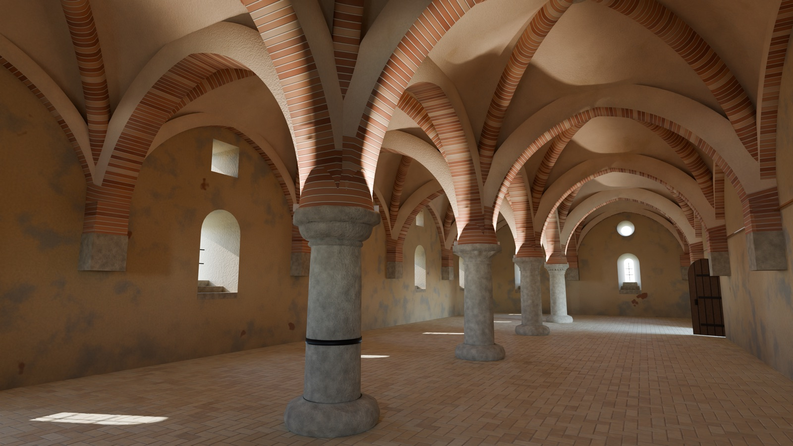
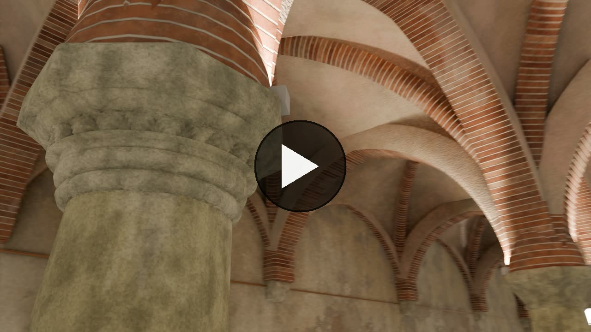

# Staffarda Abbey guesthouse: a Blender reconstruction from three photos



A procedural Blender model of the ground floor of the *foresteria* (guesthouse) of Staffarda Abbey, in Revello
(Cuneo, Italy): the two-nave hall with four stone columns and a brick rib vault that once served as the pilgrims'
refectory. It was rebuilt from three phone photos taken on 16 October 2026, with no survey, point cloud or photo
projection. Every wall, rib, capital and brick is generated by a Python script.

The result is a plausible, stylized reconstruction, not a measured or photoreal one. Dimensions come from the
perspective in the photos and are good to about 10-15 %.

## Walkthrough video

[](https://youtu.be/FdIIaSr5uAI)

**[Watch on YouTube](https://youtu.be/FdIIaSr5uAI)** (2 min 43 s): the three photos, then one continuous 1080p take
through the model, rendered in EEVEE by `blender/walkthrough.py`. Music: "Antiphona et Magnificat", Schola Gregoriana
(WSD SAC Ołtarzew), [Wikimedia Commons](https://commons.wikimedia.org/wiki/File:Schola_Gregoriana-Antiphona_et_Magnificat.ogg),
CC BY-SA 3.0; because of that ShareAlike music the video as a whole is CC BY-SA 4.0.

## The place

- **Abbazia di Santa Maria di Staffarda**, Revello (CN), Piedmont, near Saluzzo. The guesthouse stands just south
  of the main monastic complex.
- **Coordinates** of the abbey: 44°43′15″N 7°26′13″E (44.720833, 7.436944):
  [OpenStreetMap](https://www.openstreetmap.org/?mlat=44.720833&mlon=7.436944#map=18/44.720833/7.436944),
  [Google Maps](https://www.google.com/maps/search/?api=1&query=44.720833,7.436944)
- **Official page**, Fondazione Ordine Mauriziano, which owns and runs the abbey:
  [ordinemauriziano.it](https://www.ordinemauriziano.it/en/abbazia-maria-staffarda/)
- **Wikipedia:** [English](https://en.wikipedia.org/wiki/Staffarda_Abbey),
  [Italian](https://it.wikipedia.org/wiki/Abbazia_di_Santa_Maria_di_Staffarda)

## What is in this repo

| Path | What |
|---|---|
| `blender/build_foresteria.py` | Builds the whole scene and saves `foresteria.blend`. All dimensions, colours and options are constants at the top. |
| `blender/render.py` | Renders the cameras placed where the photos were taken, plus an overview and a door view. |
| `blender/render_hero.py` | One 4K still from standing eye height. |
| `blender/compare.py` | Photo-next-to-render comparison images. |
| `blender/walkthrough.py` | Renders a walkthrough video: in through the doorway and a slalom between the columns, with stops to look around. Route in `blender/video/path_plan.svg`. |
| `blender/walk.py` | Opens the model in Blender with real-time lighting and starts first-person walk mode at the doorway. |
| `blender/structural_check.py` | A first-order thrust-line check of the vault and its supports, reading its dimensions from the build script. Output in `blender/structural_report.txt`. |
| `blender/README.md` | The detailed notes: what is modelled, how the numbers were estimated, what is guessed, the lighting and colour matching, the structural check and walk mode. |
| `INITIAL_PROMPT.md` | The original request. |
| `docs/preview.jpg` | A reduced copy of the hero render. |

Not tracked, because they are heavy or can be regenerated: the three source photos, the `.blend` files, and the
`blender/renders/` and `blender/compare/` folders.

## Rebuild and render

Needs Blender 5.1 (paths below are for macOS). From `blender/`:

```bash
B=/Applications/Blender.app/Contents/MacOS/Blender
$B -b --python build_foresteria.py                      # empty hall -> foresteria.blend
FURNITURE=1 $B -b --python build_foresteria.py          # with the furniture from the photos -> foresteria_furnished.blend
WINDOW_HEADS=arched $B -b --python build_foresteria.py  # hypothesis: original arched window heads -> foresteria_arched.blend
$B -b foresteria.blend --python render_hero.py -- final F          # 3840x2160 still, about 11 min on an Apple-silicon Mac
$B -b foresteria_furnished.blend --python render.py -- final cam_photo1 cam_photo2 cam_photo3
$B -b --python compare.py                               # needs the three photos next to this README
python3 structural_check.py > structural_report.txt     # plain Python, no Blender
```

Walk through it:

```bash
$B foresteria.blend --python walk.py                    # WASD + mouse, Shift faster, Esc to cancel
```

## The model in short

- Hall of 2 naves x 5 square bays, about 10.8 x 27 m, springing at 2.5 m, keystones about 6.4 m up.
- Four round columns with different capitals (plain cushion, leaves, octagonal panels, a band of teeth) and
  different bases.
- Ribs spring higher on the side walls than on the columns, from small corbels, as measured on the photos.
- Pointed brick rib vault with round diagonal ribs, brick soffits with white lime joints, plastered sides and
  cells, and a rosette keystone in each bay.
- Pale lime-plastered walls with deep, splayed, flat-lintel window recesses and stone steps up to narrow
  round-headed lights (as today; an arched-head hypothesis is a build switch), oculi in the end walls, two
  doorways in the right wall (one with a plank door).
- Herringbone floor of about 7,800 individual worn cotto bricks.
- Each material has its own procedural weathering (Perlin and Voronoi noise): flaking wall plaster, stained and
  speckled vault plaster, mottled and chipped bricks, blotchy gneiss columns, a dusty floor.
- Colours and brightness were matched to the photos by measuring the same regions in photo and render.
- Proportions were checked with a first-order thrust-line analysis, and the model was adjusted where it failed.
  This is a plausibility check, not an engineering assessment.

See [`blender/README.md`](blender/README.md) for the details and the known limitations.

## Licence

Code (`*.py`) is MIT; renders, images and documentation are CC BY 4.0. See [LICENSE](LICENSE) and
[LICENSE-CC-BY-4.0.md](LICENSE-CC-BY-4.0.md). The source photos are not included.
